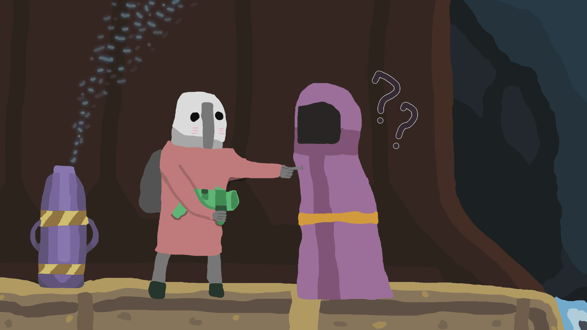

# Haptic Noita

Let the game touch you. Noita events (damage, low health, healing, wand shots, explosions, and more) drive a haptic device.

## Requirements

[Intiface Central](https://intiface.com/central/), which connects to your haptic device and runs the server this mod talks to.

## Install

1. Press the [Download](https://github.com/lamia-zamia/haptic_noita/archive/refs/heads/master.zip) button.
2. Extract the contents into your Noita `mods` folder.
3. Rename the folder from `haptic_noita-master` to `haptic_noita`.
4. In Intiface Central, pair your device and start the server (default `127.0.0.1:12345`).
5. In Noita, open **Mods** and enable **Haptic Noita**. It needs unsafe mods allowed, which Noita asks about on first enable.
6. Open the mod's settings to adjust intensity, pick a device, and press **Test**.

The address, port, and each effect's strength can be changed in the mod settings.
